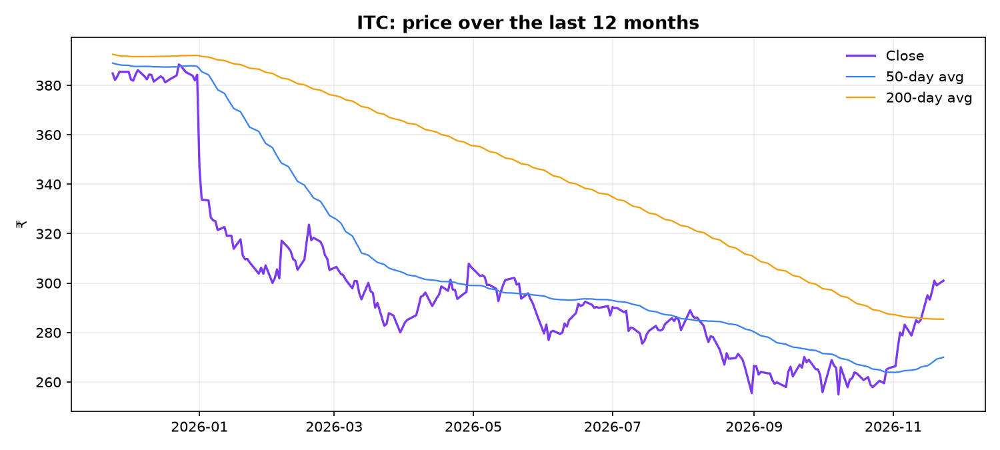

# ITC Limited (ITC)

**Sector:** Consumer Defensive  |  **Industry:** Tobacco  |  **Generated:** 23 Nov 2026

| Metric | Value | Metric | Value |
|:--|--:|:--|--:|
| Price | ₹301.00 | 1Y Return | -21.8% |
| 52W High | ₹388.41 | 52W Low | ₹255.00 |
| Market Cap | ₹377,234 cr | Beta | -0.07 |
| P/E | 19.97x | P/B | 5.29x |
| EV/EBITDA | 14.49x | ROE | 26.8% |
| Net Margin | 24.4% | Debt/Equity | 0.01x |
| Dividend Yield | 5.3% | Below 52W High | -22.5% |

## Revenue and Profit

|      |   Revenue (₹ cr) |   Net Profit (₹ cr) |   Net Margin % |
|:-----|-----------------:|--------------------:|---------------:|
| FY23 |            70245 |               19192 |           27.3 |
| FY24 |            67391 |               20459 |           30.4 |
| FY25 |            74653 |               34747 |           46.5 |
| FY26 |            78213 |               20689 |           26.5 |

_Data: Yahoo Finance. For learning purposes only, not investment advice._