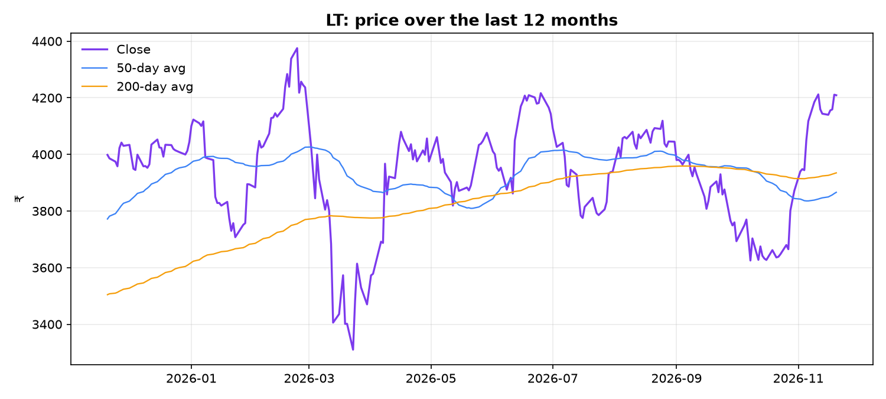

# Larsen & Toubro Limited (LT)

**Sector:** Industrials  |  **Industry:** Engineering & Construction  |  **Generated:** 21 Nov 2026

| Metric | Value | Metric | Value |
|:--|--:|:--|--:|
| Price | ₹4,209.10 | 1Y Return | 5.3% |
| 52W High | ₹4,375.36 | 52W Low | ₹3,310.07 |
| Market Cap | ₹579,125 cr | Beta | 0.49 |
| P/E | 32.44x | P/B | 5.12x |
| EV/EBITDA | 17.99x | ROE | 17.9% |
| Net Margin | 5.8% | Debt/Equity | 1.05x |
| Dividend Yield | 0.9% | Below 52W High | -3.8% |

## Revenue and Profit

|      |   Revenue (₹ cr) |   Net Profit (₹ cr) |   Net Margin % |
|:-----|-----------------:|--------------------:|---------------:|
| FY23 |           181661 |               10471 |            5.8 |
| FY24 |           219116 |               13059 |            6   |
| FY25 |           254209 |               15037 |            5.9 |
| FY26 |           284225 |               16084 |            5.7 |

_Data: Yahoo Finance. For learning purposes only, not investment advice._