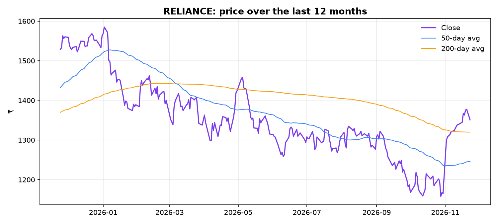

# Reliance Industries Limited (RELIANCE)

**Sector:** Energy  |  **Industry:** Oil & Gas Refining & Marketing  |  **Generated:** 23 Nov 2026

| Metric | Value | Metric | Value |
|:--|--:|:--|--:|
| Price | ₹1,351.00 | 1Y Return | -11.6% |
| 52W High | ₹1,584.97 | 52W Low | ₹1,158.00 |
| Market Cap | ₹1,828,237 cr | Beta | 0.18 |
| P/E | 22.26x | P/B | 1.94x |
| EV/EBITDA | 12.28x | ROE | 8.8% |
| Net Margin | 6.8% | Debt/Equity | 0.44x |
| Dividend Yield | 0.4% | Below 52W High | -14.8% |

## Revenue and Profit

|      |   Revenue (₹ cr) |   Net Profit (₹ cr) |   Net Margin % |
|:-----|-----------------:|--------------------:|---------------:|
| FY23 | 877835           |               66702 |            7.6 |
| FY24 | 901064           |               69621 |            7.7 |
| FY25 | 964693           |               69648 |            7.2 |
| FY26 |      1.05722e+06 |               80775 |            7.6 |

_Data: Yahoo Finance. For learning purposes only, not investment advice._