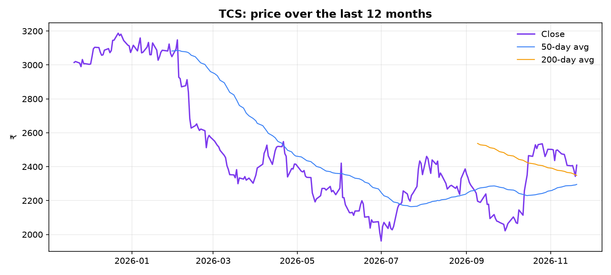

# Tata Consultancy Services Limited (TCS)

**Sector:** Technology  |  **Industry:** Information Technology Services  |  **Generated:** 20 Nov 2026

| Metric | Value | Metric | Value |
|:--|--:|:--|--:|
| Price | ₹2,408.90 | 1Y Return | -20.1% |
| 52W High | ₹3,187.34 | 52W Low | ₹1,961.36 |
| Market Cap | ₹871,561 cr | Beta | 0.07 |
| P/E | 17.15x | P/B | 7.32x |
| EV/EBITDA | 11.11x | ROE | 45.6% |
| Net Margin | 18.2% | Debt/Equity | 0.10x |
| Dividend Yield | 2.0% | Below 52W High | -24.4% |

## Revenue and Profit

|      |   Revenue (₹ cr) |   Net Profit (₹ cr) |   Net Margin % |
|:-----|-----------------:|--------------------:|---------------:|
| FY23 |           225458 |               42147 |           18.7 |
| FY24 |           240893 |               45908 |           19.1 |
| FY25 |           255324 |               48553 |           19   |
| FY26 |           267021 |               49210 |           18.4 |

_Data: Yahoo Finance. For learning purposes only, not investment advice._