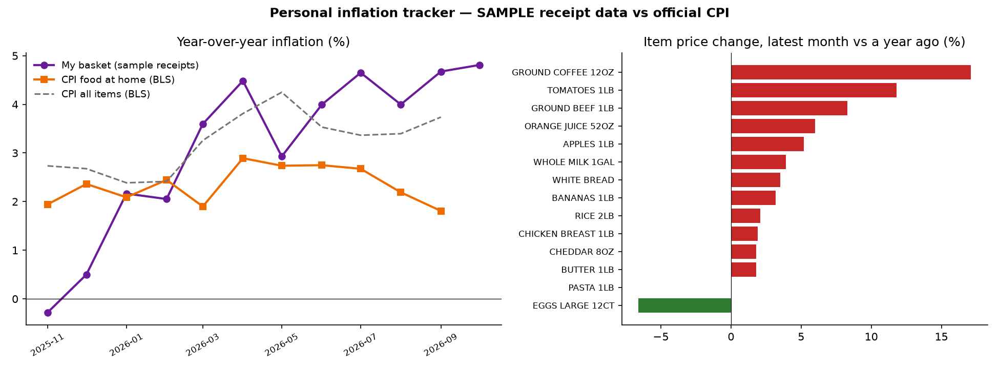

# Personal Inflation Tracker

Reads grocery receipts with OCR, builds a personal price index for the basket, and compares it with official US CPI.

> **Sample data:** the 24 receipts in `receipts/` are demo receipts from a fictional store, clearly marked "SAMPLE RECEIPT - DEMO DATA" and "NOT A REAL PURCHASE". The CPI figures are real BLS data. Drop photos of your own receipts into `receipts/` to track your real basket.

| | |
|:--|:--|
| **What was analysed** | 24 monthly sample grocery receipts (November 2024 to October 2026, 14 items in five categories, 336 line items) and the BLS CPI-U series for food at home and all items |
| **What was done** | Text extraction with Tesseract OCR; line parsing with checks (fuzzy item matching, quantity x price = line total, sum of lines = receipt total); a fixed-basket (Laspeyres) price index; year-over-year inflation by basket, category and item; comparison with BLS CPI via its public API; a Streamlit app that reads a new receipt |
| **Key finding** | OCR read 97.3% of lines with every read price exact, and rebuilt 21 smudged line totals from quantity x price. The sample basket's inflation reached 4.8% in October 2026 against 1.8% for official food-at-home CPI (September 2026), driven by coffee (+17.1%) and tomatoes (+11.8%), while eggs fell 6.6%: one household's basket can run well above the national average |



## How It Works

1. **Receipts:** `make_receipts.py` creates the sample receipt images (with slight blur and tilt so OCR has real work to do). Replace them with your own photos.
2. **OCR:** `ocr_receipts.py` runs Tesseract on each image, parses item lines and rejects any line that fails the price checks. On sample data it is scored against the known answers.
3. **Index:** `inflation.py` multiplies base-month quantities by each month's prices. Months where OCR missed an item carry the last known price (9 of 336 item-months).
4. **Benchmark:** CPI food at home (CUUR0000SAF11) and CPI all items (CUUR0000SA0), not seasonally adjusted, from the BLS API. October 2025 has no CPI release because of the federal shutdown, so that month is skipped.

| OCR check | Result |
|:--|--:|
| Line items found | 97.3% (327 of 336) |
| Prices exact, where found | 100% |
| Line totals rebuilt from qty x price | 21 |
| Receipts that reconcile to the printed total | 17 of 24 |

## Limitations

- The receipts and their prices are sample data, so the basket result shows the method, not real household inflation.
- Real receipts vary by store layout; the parser expects one item per line with quantity, unit price and total.
- A 14-item basket is far narrower than the CPI's thousands of prices.

## Run It Yourself

```bash
sudo apt install tesseract-ocr          # or: brew install tesseract
pip install -r requirements.txt
python make_receipts.py && python ocr_receipts.py && python inflation.py
streamlit run app.py
```

**Tools:** Python, Tesseract OCR, Pillow, pandas, BLS Public Data API, Matplotlib, Streamlit

_For learning purposes only._
