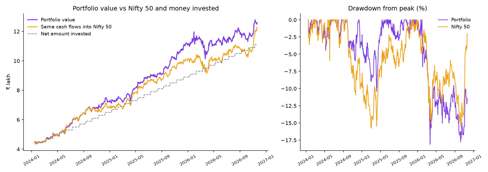
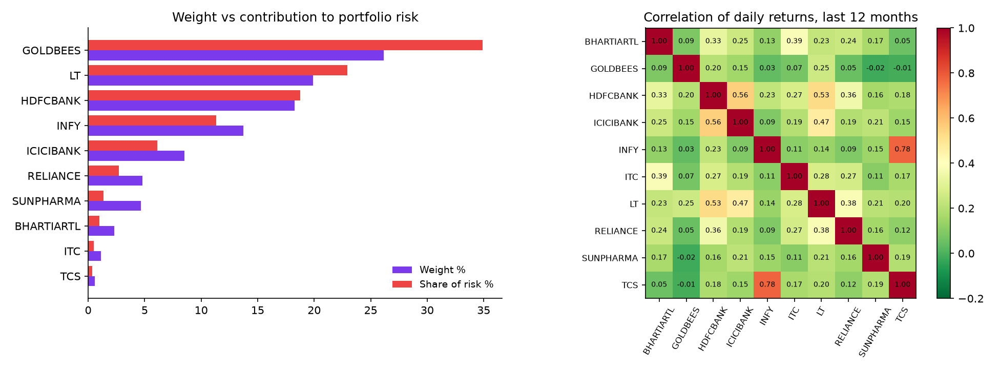

# Portfolio Performance Analytics

Measures the return, risk and diversification of an NSE stock and gold portfolio from its transaction history, and compares it with putting the same money into the Nifty 50 on the same dates.

> **Sample portfolio:** the transactions in `data/sample_transactions.csv` are illustrative (lump sums in January 2024, monthly SIPs, two switches). All prices are real NSE closing prices. Replace the file with your own trades to track your real portfolio.

| | |
|:--|:--|
| **What was analysed** | A sample portfolio of 9 NSE stocks and a gold ETF (145 transactions, ₹11.1 lakh net invested, January 2024 to November 2026), valued daily with real prices, against the Nifty 50 |
| **What was done** | Money-weighted return (XIRR) and time-weighted return; volatility, maximum drawdown, Sharpe and Sortino ratios, beta, alpha, tracking error and information ratio; a "same cash flows into Nifty 50" benchmark; diversification analysis (effective number of holdings, correlation matrix, diversification ratio, each holding's share of risk) |
| **Key finding** | The portfolio earned an XIRR of 6.5% against 5.3% for the same cash flows in the Nifty 50, with a beta of 0.82. Gold was the best diversifier (correlation of -0.03 to 0.26 with each stock) but, with 32% volatility over the past year, it made up 26% of the value and 35% of the risk. Weight and risk are not the same thing, so rebalancing should look at both |





## How It Works

1. **Holdings:** each buy or sell amount is converted into units at that day's closing price; units are tracked every trading day.
2. **Returns:** XIRR uses the actual dates and amounts of every cash flow. Time-weighted return strips out deposits so it measures the investment choices alone.
3. **Benchmark:** every rupee invested in the portfolio is also "invested" in the Nifty 50 on the same day, so both are compared on equal terms.
4. **Risk:** Sharpe and Sortino use a 6.5% risk-free rate (approximate 91-day T-bill yield). Beta and alpha are measured against the Nifty 50.
5. **Diversification:** risk contribution = weight × the holding's covariance with the portfolio ÷ portfolio variance, using the last 12 months of daily returns.

| As of 20 Nov 2026 | Portfolio | Nifty 50 (same cash flows) |
|:--|--:|--:|
| XIRR | 6.5% | 5.3% |
| Time-weighted return, total | 24.1% | 16.8% |
| Volatility | 13.4% | 13.7% |
| Maximum drawdown | -18.1% | -15.8% |
| Sharpe ratio | 0.11 | -0.06 |

## Limitations

- The transactions are a sample; the method, not the result, is the point.
- Dividends are included only through adjusted prices, and taxes and brokerage are ignored.
- Risk figures use one year of history and change as markets move.

## Run It Yourself

```bash
pip install -r requirements.txt
python tracker.py            # edit data/sample_transactions.csv with your own trades first
streamlit run app.py
```

**Tools:** Python, pandas, NumPy, SciPy, yfinance, Matplotlib, Streamlit

_For learning purposes only. Not investment advice._
