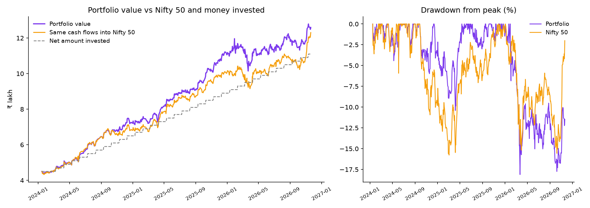
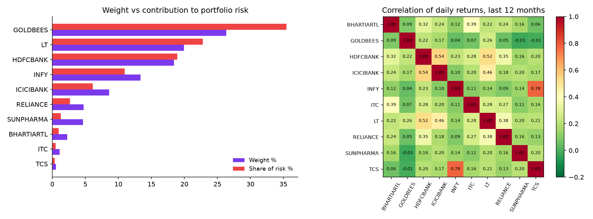

# Portfolio Performance Report — 2026-11-20

> SAMPLE portfolio (illustrative transactions) valued with real NSE prices from Yahoo Finance.

Net invested ₹1,110,000; value ₹1,259,512; the same cash flows in the Nifty 50 would be worth ₹1,230,637.

**XIRR 6.54%** vs Nifty 50 5.33% on the same cash flows.

## Risk and return (time-weighted)

|                        |   Portfolio |   Nifty 50 |
|:-----------------------|------------:|-----------:|
| annualised_return_%    |       8.038 |      5.711 |
| volatility_%           |      13.44  |     13.683 |
| sharpe                 |       0.114 |     -0.058 |
| sortino                |       0.152 |     -0.08  |
| max_drawdown_%         |     -18.11  |    -15.767 |
| best_day_%             |       3.541 |      3.818 |
| worst_day_%            |      -4.587 |     -5.929 |
| beta                   |       0.821 |    nan     |
| alpha_%                |       2.186 |    nan     |
| tracking_error_%       |       7.766 |    nan     |
| information_ratio      |       0.3   |    nan     |
| correlation_with_nifty |       0.836 |    nan     |

## Calendar-year returns

|   Date |   portfolio_% |   nifty_% |
|-------:|--------------:|----------:|
|   2024 |         13.5  |      7    |
|   2025 |         16.2  |     10.51 |
|   2026 |         -5.93 |     -1.26 |

## Holdings

|            |   value_inr |   weight_% |   volatility_% |   risk_contribution_% | sector        |
|:-----------|------------:|-----------:|---------------:|----------------------:|:--------------|
| GOLDBEES   |      331800 |      26.34 |           31.7 |                 35.46 | Gold          |
| LT         |      251440 |      19.96 |           25.6 |                 22.79 | Capital Goods |
| HDFCBANK   |      232286 |      18.44 |           23.4 |                 18.91 | Financials    |
| INFY       |      167972 |      13.34 |           31.7 |                 10.98 | IT            |
| ICICIBANK  |      108446 |       8.61 |           21   |                  6.13 | Financials    |
| RELIANCE   |       59999 |       4.76 |           24.1 |                  2.65 | Energy        |
| SUNPHARMA  |       58282 |       4.63 |           19.7 |                  1.27 | Healthcare    |
| BHARTIARTL |       28498 |       2.26 |           21.3 |                  0.96 | Telecom       |
| ITC        |       13991 |       1.11 |           23.1 |                  0.48 | FMCG          |
| TCS        |        6797 |       0.54 |           29.9 |                  0.37 | IT            |

_For learning purposes only, not investment advice._