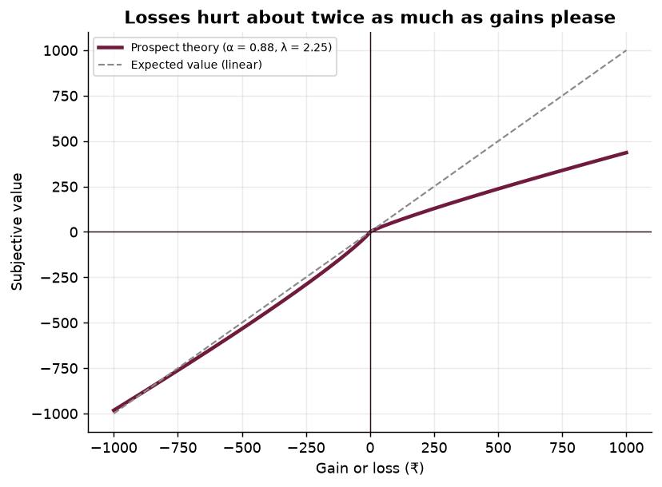
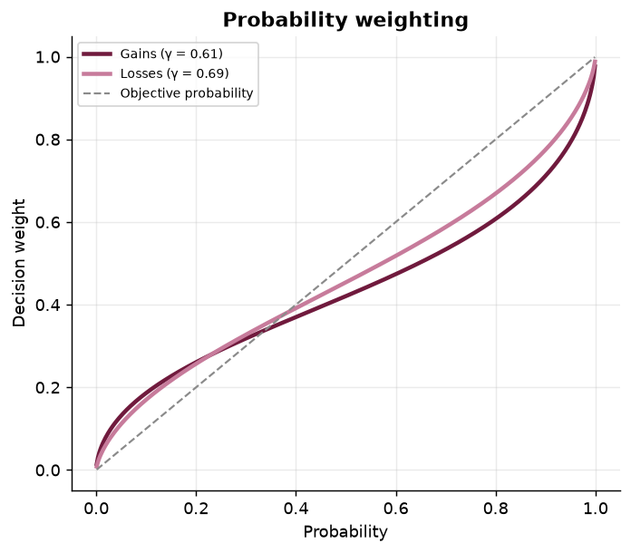
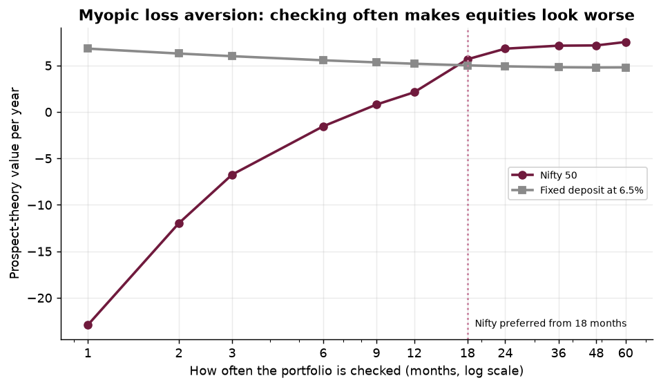
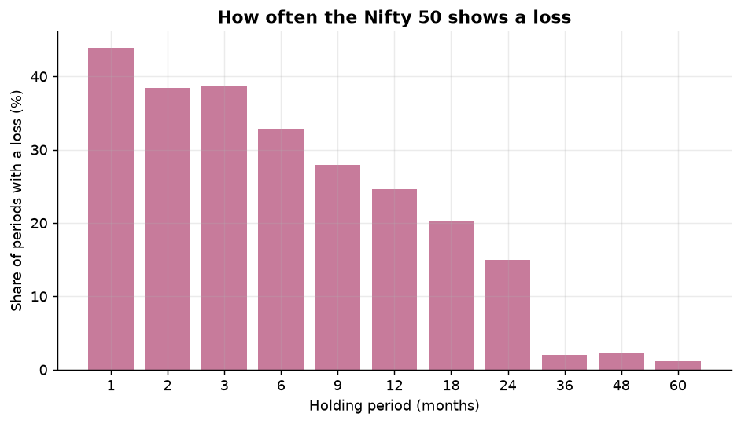

# Prospect Theory and Myopic Loss Aversion on the Nifty 50

Models Daniel Kahneman and Amos Tversky's *Prospect Theory: An Analysis of Decision under Risk* (Econometrica, 1979), using the cumulative version (1992), and applies it to a question every Indian saver faces: equities or a fixed deposit?

| | |
|:--|:--|
| **What was analysed** | Six classic gambles; 19 years of Nifty 50 month-end prices (September 2007 to November 2026, Yahoo Finance) turned into every overlapping 1- to 60-month holding period; a fixed deposit at 6.5% a year (assumed) |
| **What was done** | Value function (α = 0.88, loss aversion λ = 2.25) and probability weighting function (γ = 0.61 gains, 0.69 losses); cumulative prospect theory values and certainty equivalents; Benartzi-Thaler (1995) test of how the attractiveness of the Nifty changes with how often the investor checks the portfolio |
| **Key finding** | The model reproduces the paper's behaviour: a 50/50 bet to win or lose ₹1,000 is rejected, so is one paying ₹2,500 against a ₹1,000 loss, while a 1% chance at ₹1 lakh is valued at ₹3,724, almost four times its ₹1,000 expected value (why lotteries sell). On the Nifty, 44% of months showed a loss but only 1% of five-year periods did. An investor who checks monthly prefers the fixed deposit; the Nifty only wins once the portfolio is checked every 18 months or less often, close to Benartzi and Thaler's US estimate of about a year |

**Live report:** [outputs/REPORT.md](outputs/REPORT.md), refreshed every Monday by GitHub Actions.









## How It Works

1. **Value function:** v(x) = x^0.88 for gains and −2.25 × (−x)^0.88 for losses, measured from a reference point of zero.
2. **Weighting:** w(p) = p^γ / (p^γ + (1 − p)^γ)^(1/γ), applied to cumulative probabilities (rank-dependent weights), separately for gains and losses.
3. **Certainty equivalent:** the sure amount with the same prospect-theory value as the gamble.
4. **Myopic loss aversion:** for each checking interval h, the empirical distribution of h-month Nifty returns is valued with the model and compared with the fixed deposit's sure return over the same h.

## Limitations

- Parameters are Tversky and Kahneman's 1992 estimates, not fitted to Indian investors.
- The price index excludes dividends, which slightly understates the Nifty; overlapping windows are not independent.
- Returns are nominal; the reference point is fixed at zero.

## Run It Yourself

```bash
pip install -r requirements.txt
python prospect_theory.py
```

**Tools:** Python, pandas, NumPy, Matplotlib, yfinance

_For learning purposes only. Not investment advice._
