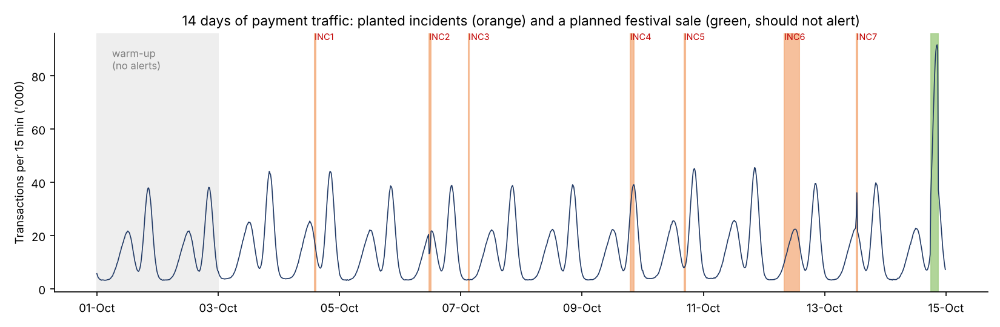
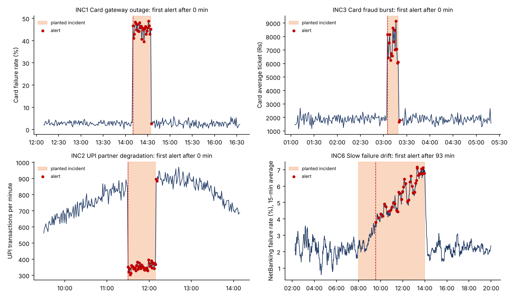
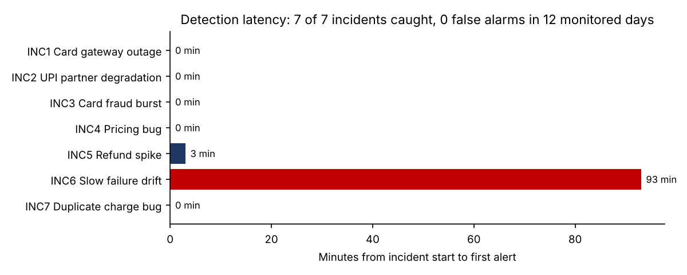

# Real-Time Business Anomaly Detection | Python

**[Interactive demo](https://claude.ai/artifact/FKL5CFuR285YSbzgCNuDuA)** · explore the results in your browser

A streaming monitor for a payments business. It reads one minute of data at a time, scores 15 metric series against a seasonal baseline, raises alerts, merges them into incidents and suggests a likely cause, the way an operations or risk team would want to hear about a gateway outage or a pricing bug while it is still happening.

| | |
|:--|:--|
| **What was analysed** | 14 days of simulated minute-level payments for a fictional Indian payments company: 20,160 minutes, 3 channels (UPI, Card, NetBanking), 19.9 million transactions worth about ₹2,300 crore. Seven incidents are planted on known dates, plus a planned festival sale that should not raise an alarm |
| **What was done** | A detector that runs minute by minute on volume, failure rate, refund rate and average ticket size for each channel (and volume and rates for the total); a seasonal baseline for volume (same time of day over the last 7 days), exact Poisson tests for failure and refund counts, a CUSUM chart for slow drifts, alert-to-incident grouping with a root-cause hint, and calendar suppression for planned events |
| **Key finding** | All 7 incidents were caught with no false alarms over 12 monitored days. Six were flagged in the first 3 minutes; the slow failure-rate drift was caught after 93 minutes, when the NetBanking failure rate had crept from 2.2% to about 3.5%. The festival sale (volume ×2.3) raised no alert. Re-run on 5 other random datasets, the detector caught 35 of 35 incidents with 1 false alarm in 60 monitored days, at about 2 ms of processing per minute of data |







## Planted Incidents and What the Detector Said

| Incident | What happened | First alert | Lead signal | Likely cause shown |
|:--|:--|:--|:--|:--|
| INC1 Card gateway outage | Card failures jump to ~45% for 25 min | 0 min | Card failure rate up | Payment failures: gateway or bank outage |
| INC2 UPI partner degradation | UPI volume falls ~60% for 40 min | 0 min | UPI volume down | Traffic drop: partner, app or network outage |
| INC3 Card fraud burst | Card ticket ×4 and volume +40% at 3 am | 0 min | Card average ticket up | Unusually large payments: possible fraud |
| INC4 Pricing bug | Average ticket halves on all channels for 90 min | 0 min | UPI average ticket down | Low ticket size: pricing or discount bug |
| INC5 Refund spike | NetBanking refunds ~9% for 30 min | 3 min | NetBanking refund rate up | Refund surge: fulfilment or merchant problem |
| INC6 Slow failure drift | NetBanking failures creep from 2% to 7% over 6 hours | 93 min | NetBanking failure rate up (CUSUM) | Payment failures: gateway or bank outage |
| INC7 Duplicate charge bug | UPI volume doubles at the same ticket size | 0 min | UPI volume up | Traffic spike: duplicate charges, bots or an unplanned campaign |

## How It Works

| Metric | Baseline | Test |
|:--|:--|:--|
| Volume | Median of the same time of day (±15 min) over the previous 7 days | Poisson noise plus 10% extra dispersion |
| Failure rate | Trailing 24-hour rate for that channel | Exact Poisson mid-p test on the failure count, so small night-time counts do not trigger alarms |
| Refund rate | Trailing 24-hour rate | Exact Poisson mid-p test |
| Average ticket | Trailing 24-hour average | z-score from the spread of individual payment sizes |

- **Alert rules:** a point alert at |z| ≥ 5; a sustained alert when 3 of the last 5 minutes have |z| ≥ 3.5; a CUSUM alarm (k = 0.5, h = 10) for slow drifts in failure and refund rates.
- **Clean baselines:** minutes that raised an alert are kept out of later baselines, so an outage does not teach the model that outages are normal.
- **Planned events:** volume is not scored during events in `data/business_calendar.csv` (a festival sale here), but failures, refunds and ticket sizes still are.
- **Incidents:** alerts within 15 minutes of each other are merged; the series with the largest |z| sets the lead signal and the likely-cause text.
- **Real time:** `StreamingDetector.update()` takes one minute and returns alerts, so it can sit behind a Kafka topic or a database poll unchanged.

## Files

| File | Purpose |
|:--|:--|
| `generate_stream.py` | Simulates the 14-day stream with daily and weekly seasonality, growth, noise and the planted incidents |
| `detector.py` | The streaming detector and the incident grouping |
| `run_realtime.py` | Replays the stream minute by minute; `--live 20` prints alerts as they fire |
| `make_charts.py` | Charts above |
| `test_detection.py` | Checks that every incident is caught, the festival is silent, false alarms stay under one a day and the drift is caught within 3 hours |
| `outputs/` | `alerts.csv` (542 alerts), `incidents.csv`, `evaluation.csv`, `summary.json`, charts |

## Run It

```
pip install pandas numpy scipy matplotlib
python generate_stream.py
python run_realtime.py            # or: python run_realtime.py --live 20
python make_charts.py
python test_detection.py
```

## Limitations

- The data is simulated, and the incidents are planted with known start times, so real data would need tuning of thresholds and baselines.
- The volume baseline needs a week of history; a new channel or a big structural change would raise alerts until the baseline catches up.
- Slow drifts are the hardest case: the 6-hour failure drift was caught only after 93 minutes.

*Fictional company and synthetic data, built for learning.*
